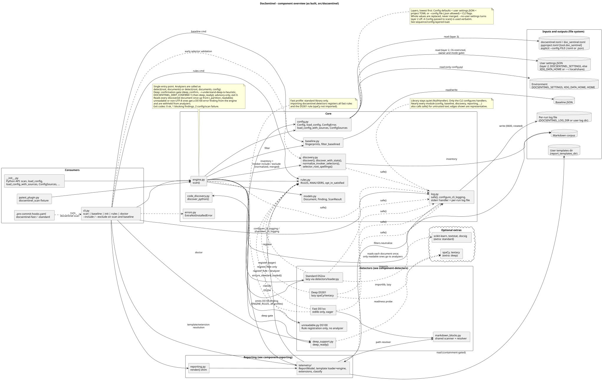
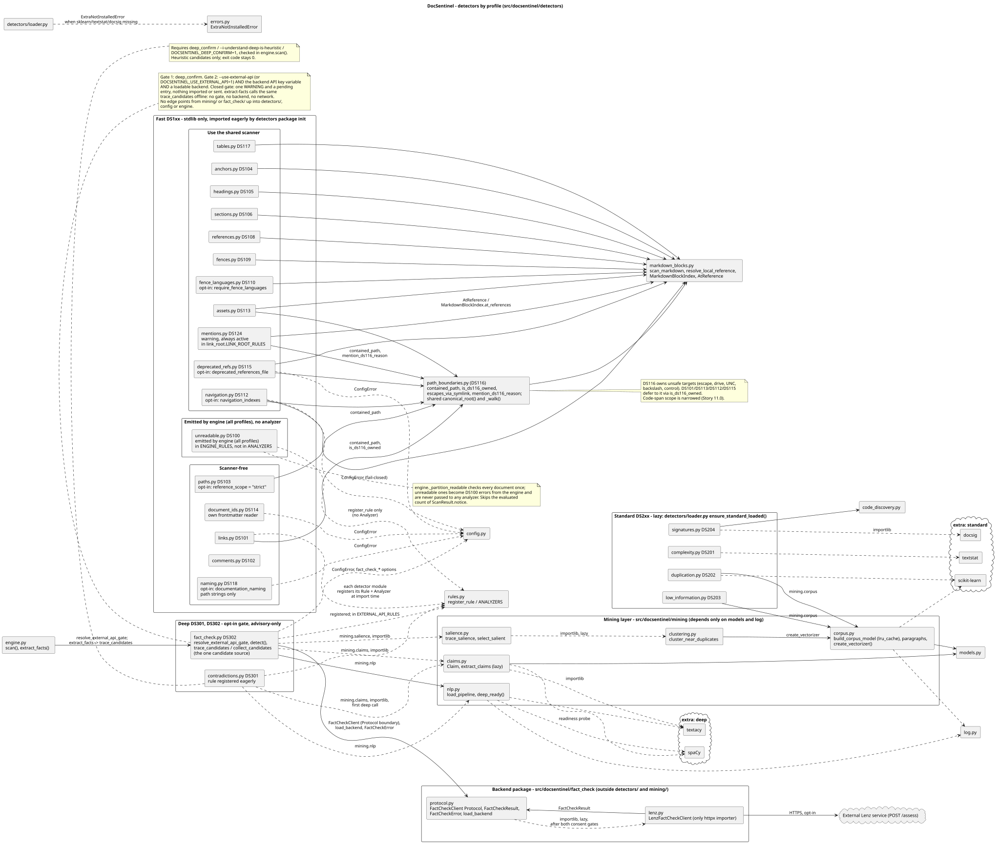
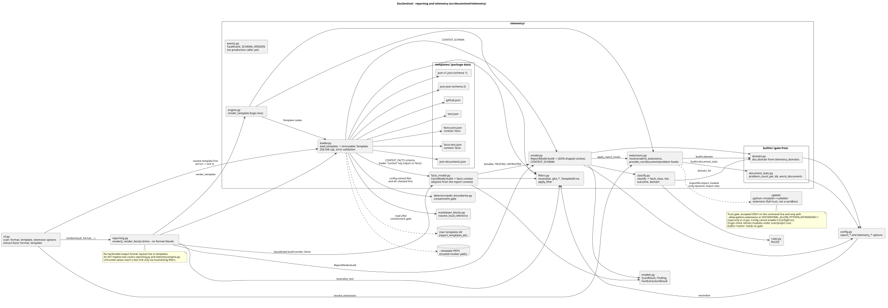
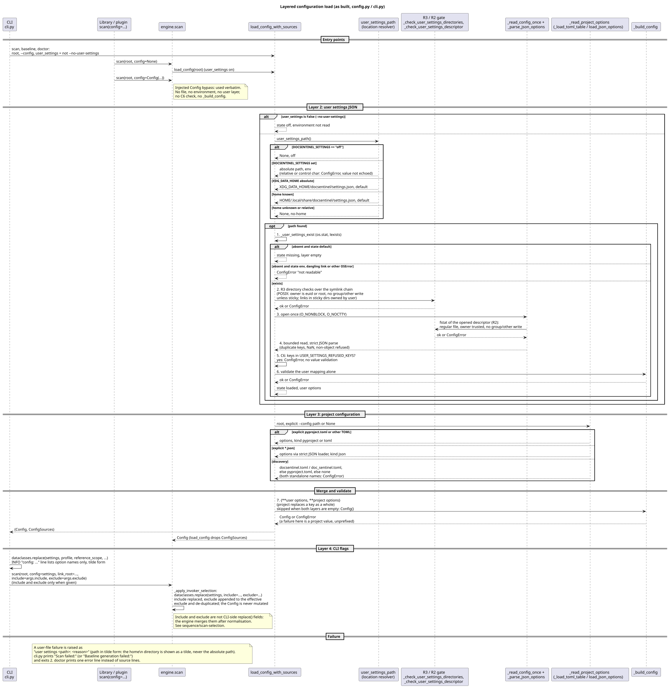
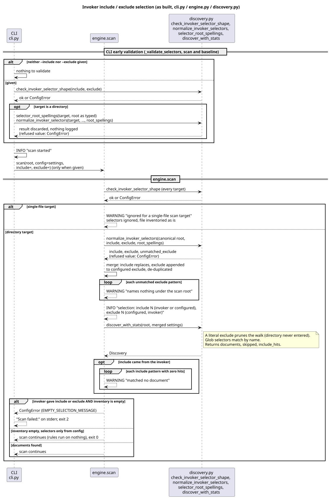
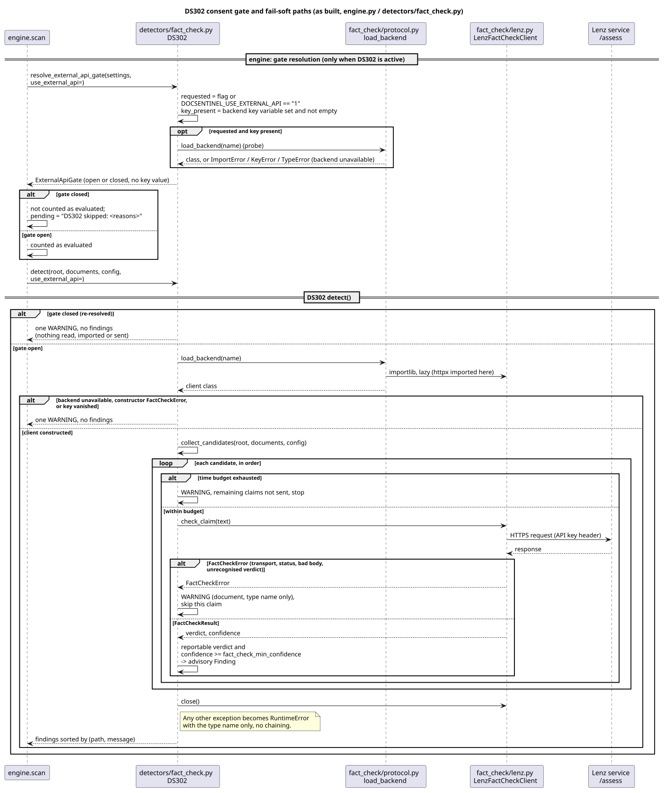
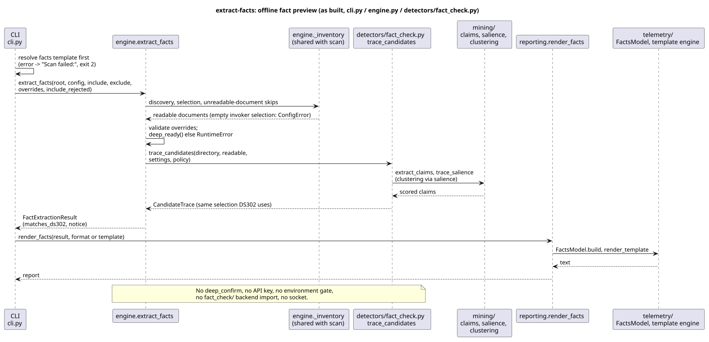

# Diagrams

Diagrams of the as-built DocSentinel package (`src/docsentinel/`), grouped by
diagram kind, one subdirectory per diagram. Each `.puml` source sits beside its
rendered `.svg` and `.png`. Re-render from the repository root with
`python .claude/skills/plantuml/scripts/convert_puml.py <path>.puml --format svg`
(repeat with `--format png`).

## Component diagrams (`component/`)

### Overview



### Detectors by profile



### Reporting and telemetry



## Sequence diagrams (`sequence/`)

### Layered configuration load



### Invoker include and exclude selection



### DS302 consent gate and fail-soft paths



### extract-facts offline preview



## Layout

```text
docs/diagrams/
├── README.md
├── component/
│   ├── overview/    component-overview.{puml,svg,png}
│   ├── detectors/   component-detectors.{puml,svg,png}
│   └── reporting/   component-reporting.{puml,svg,png}
└── sequence/
    ├── config-layered-load/   config-layered-load.{puml,svg,png}
    ├── ds302-fact-check-gate/ ds302-fact-check-gate.{puml,svg,png}
    ├── extract-facts/         extract-facts.{puml,svg,png}
    └── scan-selection/        scan-selection.{puml,svg,png}
```

New diagram kinds (state, deployment, …) get a sibling directory
next to `component/`, with one subdirectory per diagram.
